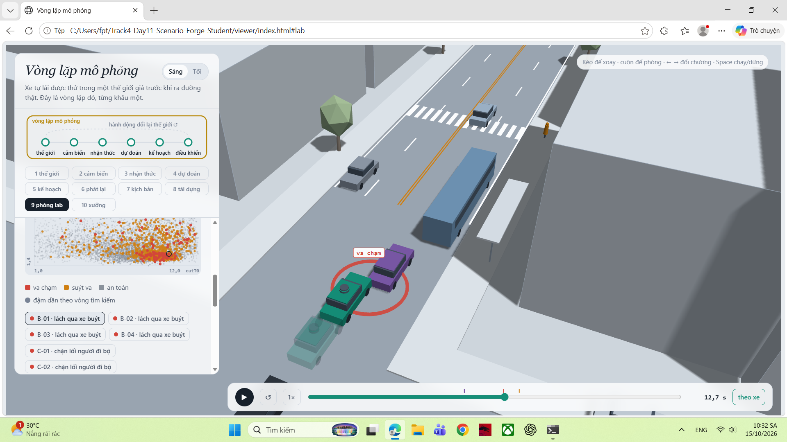
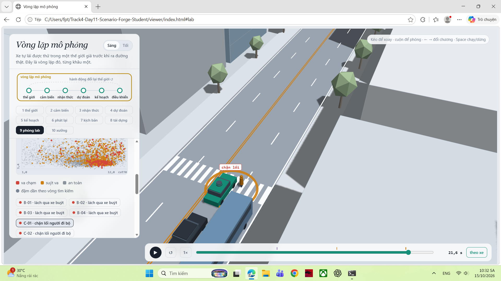
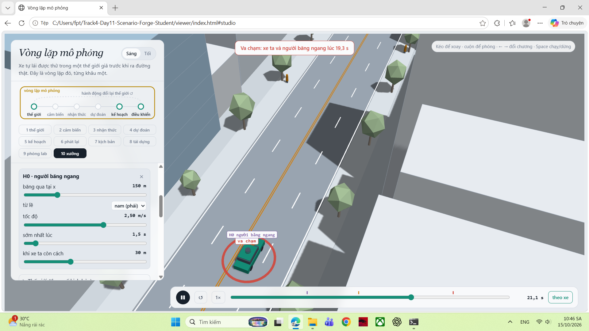

MSSV: 2A202602862

# Lab 11 · Scenario Forge — báo cáo

Mỗi câu: trả lời ngắn, **trích số từ `evidence/`** (ghi tên file và trường, ví dụ `mc.json: crashes = 4`). Grader chạy lại với MSSV của bạn; số không khớp `evidence/` thì mất điểm phần D (RUBRIC), và câu dựa trên số sai khó được điểm đầy đủ. Không cần văn hay: một bảng nhỏ và hai, ba câu giải thích là đủ.

Thị trấn của bạn (`meta.json: _run.town`): **D** (khô hơn, người đi bộ cẩn thận hơn, xe chuyển làn hay phanh ngay sau khi vào làn: `space.py: VARIANTS` D có `p_bin = (wet 0,15; pedLook 0,90; brakes 0,20)`, `cut_gap_median = 14 m`).

Ghi chú chạy: MSSV có chữ cái nên mọi bước được chạy với `LAB11_MSSV=2A202602862` (cách grader truyền MSSV); không bước nào dùng `--quick` (`meta.json: _run.quick = false`).

## 1. Phát lại log có trung thực không? (bước A)

| `replay.json` | Giá trị |
|---|---|
| `n` / `n_used` | 400 / 398 |
| `dropped_human_crash_logs` (người lái tự va chạm, bỏ) | 2 |
| `replay.crashes` (planner trên log phát lại) | **110**: `rear` 101, `side` 9 |
| `reactive.crashes` (planner trong thế giới phản ứng) | **0** |
| `crash_in_both` | 0 |

Gần như mọi va chạm "phát lại" là `rear` vì planner thận trọng hơn người lái trong log: nó giảm tốc sớm hơn gần vạch qua đường bị xe buýt che (`cautionV`). Xe bám đuôi (TG) trong log chỉ chạy lại đúng quỹ đạo đã ghi; quỹ đạo đó được ghi khi xe phía trước là người lái thật, nên **TG không biết planner phanh sớm hơn** và đâm vào đuôi. Đó là va chạm **giả**: trong thế giới phản ứng, TG là tác nhân IDM thấy xe ta chậm lại và phanh theo, nên cùng 398 kịch bản cho 0 va chạm và `crash_in_both = 0`. 9 va chạm `side` cùng cơ chế: xe chuyển làn C2 đi đúng đường đã ghi, chen vào chỗ mà trong log còn trống nhưng planner đang chiếm.

Ví dụ `replay_only[0]` (`scenario 0`, `contact = rear`, `min_ttc_reactive = 3,0 s`): lúc 18,9 s, ở x ≈ 112 m (ngay trước vạch qua đường, cạnh xe buýt), planner đang bò chậm dần 1,5 → 0,5 m/s vì vạch bị che. Người lái trong log thì đã dừng hẳn rồi tăng tốc lại (0 → 1,8 m/s). TG phát lại theo người lái nên tăng tốc và tông đuôi xe ta (sự kiện `fake = true`). Trong thế giới phản ứng, TG giữ khoảng cách, TTC nhỏ nhất vẫn 3,0 s: không có gì nguy hiểm.

## 2. Kịch bản bất khả thi (bước B)

Luật trong `lab11/feasible.py: is_feasible` (loại nếu bất kỳ luật nào đúng):

| Luật | Căn cứ vật lý |
|---|---|
| a_lat = (π/cutDur)²·3,5/2 > μ·g | Chuyển làn 3,5 m theo dạng cosin trong `cutDur` giây cần gia tốc ngang cực đại đó; lốp chỉ cho tối đa μ·g (μ = 0,8 khô → 7,8 m/s²; 0,5 ướt → 4,9 m/s²). Vượt thì xe trượt, không ai lái được như vậy. |
| cutBrake > μ·g | Phanh không thể vượt giới hạn bám đường μ·g. |
| pedV > 2,5 m/s | Tốc độ đi bộ người lớn ~1,2–1,5 m/s; > 2,5 m/s là chạy, không còn là "người đi bộ qua đường" mà mô hình người đi bộ mô tả. |
| cutV ∉ (0, 22] m/s | Xe đứng yên hoặc lùi không "chuyển làn"; > 22 m/s (~80 km/h) vượt xa tốc độ hợp lý của con phố đô thị này. |

`hunt.json: infeasible`: `crosswalk_block` **7**, `bus_bypass` 6, `rear_ended` 5, `cut_in` 4 (và `mc.json: infeasible = 18` trên 3 000 mẫu tự nhiên). Cuộc săn `crosswalk_block` sinh nhiều nhất vì điểm nguy hiểm của nó là khoảng phanh còn lại trước người đi bộ: người đi **nhanh hơn** bước ra vạch sớm hơn, nên kéo `pedV` lên làm điểm "nguy hiểm" hơn, và CEM đẩy đề xuất về phía người chạy > 2,5 m/s. Tương tự, chuyển làn cực gắt (cutDur nhỏ) làm TTC với C2 nhỏ nhất. Kịch bản bất khả thi luôn là "nguy hiểm nhất", nên CEM bị chúng hút. Nếu **đếm** chúng là va chạm, ước lượng bị thổi phồng bằng những tai nạn không thể xảy ra, và cuộc săn hội tụ vào vùng bất khả thi thay vì vùng va chạm thật; vì thế chúng bị loại trước khi chạy và không bao giờ được đếm.

## 3. Monte Carlo cho bạn biết gì (bước C1)

`mc.json`: **k = 0**, **n = 3 000**, p̂ = 0, khoảng Wilson 95 % = **[0; 1,28·10⁻³]** (`hi = 0.0012789`).

- Khoảng chuẩn sẽ là [0, 0] ("không bao giờ va chạm"), sai; Wilson cho cận trên ~3,8/n.
- Muốn khoảng ±20 % của p cần 1,96·√((1−p)/(n·p)) ≤ 0,2 ⇒ **n ≈ 96/p**. Với p ≈ 2,9·10⁻⁴ (trung vị `total` của IS, câu 4) cần **≈ 330 000** lần chạy; ngay cả với cận trên 1,28·10⁻³ cũng cần ≈ 75 000. 3 000 lần chạy chỉ cho biết p < 1,3·10⁻³.
- **Mọi** kiểu (`bus_bypass`, `cut_in`, `crosswalk_block`, `rear_ended`, `other`) đều **chưa hề xuất hiện** (`mc.json: per_mode.*.k = 0`). Con số đúng cần báo cho mỗi kiểu là cận trên Wilson 95 %: **P < 1,28·10⁻³**, không phải 0.

## 4. Importance sampling, ESS và độ suy biến (bước C3)

`estimate.json` (n = 600 mỗi kiểu mỗi seed; `budget = 16 800` lần chạy cho cả săn + ước lượng):

| Seed | Kiểu | `p` | `hits` | `ess` | `top_share` |
|---|---|---|---|---|---|
| 0 | bus_bypass | 2,60·10⁻³ | 62 | 121,4 | **0,92** |
| 0 | cut_in | 0 → `upper_zero_hits` 0,025 | 0 | 124,9 | 0 |
| 0 | crosswalk_block | 4,50·10⁻⁷ | 127 | 120,1 | 0,28 |
| 0 | rear_ended | 0 → `upper_zero_hits` 0,025 | 0 | 118,1 | 0 |
| 1 | bus_bypass | 2,02·10⁻⁴ | 44 | 133,3 | 0,26 |
| 1 | cut_in | 0 → `upper_zero_hits` 0,025 | 0 | 113,1 | 0 |
| 1 | crosswalk_block | 1,23·10⁻⁷ | 117 | 128,1 | 0,29 |
| 1 | rear_ended | 0 → `upper_zero_hits` 0,025 | 0 | 123,4 | 0 |
| 2 | bus_bypass | 2,70·10⁻⁴ | 37 | 131,2 | **0,78** |
| 2 | cut_in | 0 → `upper_zero_hits` 0,025 | 0 | 132,4 | 0 |
| 2 | crosswalk_block | 2,10·10⁻⁵ | 115 | 113,1 | **0,98** |
| 2 | rear_ended | 0 → `upper_zero_hits` 0,025 | 0 | 107,0 | 0 |

`total` theo seed: 2,60·10⁻³ · 2,02·10⁻⁴ · 2,91·10⁻⁴ (trung vị **2,91·10⁻⁴**); `other` = 0 lấy từ `mc.json` (k = 0/3 000, cận trên 1,28·10⁻³).

- **Ba seed không đồng ý**: `bus_bypass` seed 0 cao gấp ~10 lần seed 1 và 2; `crosswalk_block` seed 2 cao gấp ~50–170 lần seed 0, 1. Cả ba đều **nằm dưới** cận trên Monte Carlo 1,28·10⁻³ trừ seed 0 của `bus_bypass` (2,6·10⁻³, cao hơn cận MC), nên seed 0 rất có thể là ước lượng bị một mẫu kéo lên.
- **`top_share` lớn**: `bus_bypass` seed 0 (0,92) và seed 2 (0,78), `crosswalk_block` seed 2 (0,98). Khi đó 92–98 % con số đến từ **một** mẫu có trọng số w = p/q khổng lồ (một mẫu nằm ở vùng q hiếm mà p không hiếm). Bỏ mẫu đó đi thì ước lượng sụp xuống cỡ các seed khác: con số thực chất là "trọng số của một mẫu / 600", và ±1,96·se cũng hẹp sai. Đó chính là những seed lệch khỏi số còn lại. `top_share` thấp (seed 1) cũng không chứng minh là đúng: q có thể bỏ sót cả một vùng va chạm.
- `crosswalk_block` có 115–127 `hits` mà p chỉ 10⁻⁷–10⁻⁵: CEM đã kéo q về chỗ va chạm **dễ nhất** nhưng rất hiếm dưới p (bẫy 3), nên mỗi hit mang trọng số cực nhỏ.
- `cut_in`, `rear_ended`: 0 hits ⇒ báo **cận trên `upper_zero_hits` = 3/(0,2·600) = 0,025**, không báo 0 và không dùng 3/ESS.
- **Ngân sách**: IS dùng 16 800 lần chạy (`budget`). Seed 1 cho `bus_bypass` se/p = 7,8·10⁻⁵/2,02·10⁻⁴ ≈ 0,39; Monte Carlo cần n ≈ (1−p)/(p·0,39²) ≈ **33 000** lần chạy để có cùng độ chính xác tương đối, và ≈ 96/p ≈ **475 000** để đạt ±20 %. Với độ phân tán giữa các seed như trên, lợi thế thật của IS nhỏ hơn con số danh nghĩa này.
- **`other`** lấy từ Monte Carlo C1 (`estimate.json: other.source = mc.json`): va chạm không thuộc kiểu nào không có điểm nguy hiểm riêng để CEM leo lên, nên không săn được; MC là nguồn không chệch duy nhất cho phần đó.

## 5. Các kiểu thất bại (bước C2 + 3D)

**`bus_bypass` (lách qua xe buýt)**: `evidence/shots/bus_bypass.png`, kịch bản B-01 lúc 12,7 s.

Xe buýt đỗ ở điểm dừng chắn làn phải. Xe hàng xóm C2 phải lách qua xe buýt, chen sang làn xe ta khi đang chạy chậm (x < 112 m, < 6 m/s). Planner chỉ coi C2 là "xe phía trước" khi C2 đã lấn vào trong ngưỡng ngang `cutinLat = 2,15 m`; lúc C2 mới chen nửa thân, planner vẫn bám theo xe trước cũ và giữ tốc độ, đến khi C2 lọt vào hành lang thì không phanh kịp: xe ta (xanh) đâm C2 (tím) ở x ≈ 93 m.

**`crosswalk_block` (chặn lối người đi bộ)**: `evidence/shots/crosswalk_block.png`, kịch bản C-01 (sự kiện lúc 21,35 s, ảnh lúc 21,6 s).

Người đi bộ P1 đứng sau xe buýt đỗ, xe ta không thấy (chỉ xe buýt che tầm nhìn). P1 ngó qua xe buýt, thấy khe đủ rộng thì bước ra. Khi P1 lọt vào tầm cảm biến, planner phanh gấp và dừng được, nhưng thân xe đã nằm trên vạch (x ≈ 121 m); P1 không bước vào thân xe nên phải đứng lại giữa vạch.

**Không tìm thấy**: `cut_in` và `rear_ended`. `hunt.json: found`: cuộc săn `cut_in` chỉ ra `bus_bypass: 26`; cuộc săn `rear_ended` ra `bus_bypass: 9, crosswalk_block: 1`. Mức tin: chỉ biết P < 1,28·10⁻³ (MC) và < 0,025 (`upper_zero_hits`); cuộc săn không thấy nghĩa là điểm nguy hiểm của chúng dẫn về `bus_bypass`, không phải là chúng bằng 0.

**Nếu chỉ một cuộc săn chung**: CEM co về một kiểu. Bằng chứng ngay trong `hunt.json`: ba trong bốn cuộc săn (`bus_bypass` 91, `cut_in` 26, `rear_ended` 9) đều trôi về `bus_bypass`, kiểu dễ va chạm nhất. Một cuộc săn chung sẽ chỉ báo `bus_bypass` và gần như chắc chắn bỏ sót `crosswalk_block` (chỉ cuộc săn riêng của nó mới tìm ra 65 lần). Vì thế mỗi kiểu cần cuộc săn riêng với điểm nguy hiểm riêng.

## 6. Sửa planner (bước E + 3D)

Policy được chọn (`fix.json: chosen.policy`): **`cutinLat = 3.0`** (các núm khác giữ mặc định).

| | `fail` | `fail_hi_seen` | `fail_hi` | quãng đường (m) | phanh gấp |
|---|---|---|---|---|---|
| Gốc, TRAIN (`baseline_train`) | 2,57·10⁻⁴ | 6,39·10⁻⁴ | 6,39·10⁻⁴ | 217,5 | 7,33 |
| Bản sửa, TRAIN (`chosen`) | 1,77·10⁻⁷ | 4,36·10⁻⁷ | 4,36·10⁻⁷ (`unseen = [bus_bypass]`) | 217,5 | 7,21 |
| Gốc, TEST (`baseline_test`) | **8,19·10⁻⁴** | 2,04·10⁻³ | 3,31·10⁻³ | 218,6 | 8,02 |
| Bản sửa, TEST (`chosen_test`) | **2,42·10⁻⁶** | **5,45·10⁻⁶** | **3,88·10⁻²** | 218,5 | 7,60 |

TRAIN chỉ để sàng; con số báo là TEST (seed mới + cuộc săn mới nhắm vào chính policy đó). Trên TEST, bản sửa không có hit `bus_bypass` nào (`chosen_test.bus_bypass.hits = 0`, kiểu `unseen`), `crosswalk_block` 2,42·10⁻⁶ (gốc 2,89·10⁻⁶), quãng đường giảm 0,05 %, phanh gấp giảm 8,02 → 7,60.

**Vì sao `fail_hi` của bản sửa (3,88·10⁻²) lớn hơn `fail` của gốc (8,19·10⁻⁴)** dù bản sửa tốt hơn thật: `bus_bypass` không còn hit nào nên cận của nó là `upper_zero_hits = 3/(0,2·400) = 0,0375`; cộng thêm cận các va chạm khác trên tập tự nhiên (`other_crashes.hi = 1,28·10⁻³`) và `crosswalk_block` 5,45·10⁻⁶ ⇒ 3,88·10⁻². Với n = 400 không thể chứng nhận một kiểu đã biến mất dưới ~10⁻²; `fail_hi_seen` (5,45·10⁻⁶) là cái dữ liệu cho thấy, `fail_hi` là cận hợp lệ.

**Ảnh có bóng mờ**: `evidence/shots/bus_bypass.png` (B-01, 12,7 s, ảnh ở câu 5). Với các va chạm săn được dưới policy gốc, chương 9 vẽ **xe đặc = policy gốc** (đâm C2) và **bóng mờ = bản sửa** `cutinLat = 3.0`: bóng mờ đã phanh, đi sau xe đặc và không chạm C2. Chạy lại bằng Python: cả 4 kịch bản B-01…B-04 đều va chạm với gốc và không va chạm với bản sửa. Cơ chế: hành lang ngang rộng hơn (3,0 m) làm planner coi C2 là xe phía trước ngay khi C2 bắt đầu chen qua xe buýt, nên giảm tốc sớm. Bản sửa **không** cứu C-01…C-04 (cùng thời điểm chặn lối), vì `cutinLat` không liên quan đến người đi bộ.

**Núm "nghe thì an toàn hơn" nhưng phản tác dụng**: **`T = 2.0`** (giữ khoảng cách thời gian xa hơn). TRAIN: `fail` 2,10·10⁻³ so với gốc 2,57·10⁻⁴ (**gấp ~8 lần**); `bus_bypass` hits 46 (gốc 27), `crosswalk_block` 100 (gốc 74). Thế giới phản ứng: khe trống trước xe ta lớn hơn, nên xe chuyển làn C2 (chấp nhận khe theo `cutGap`) **chen vào** nhiều hơn và sát hơn, đúng chỗ đang lách qua xe buýt; và xe ta đi chậm hơn nên đến vạch đúng lúc người đi bộ sau xe buýt bước ra. Tương tự `cautionV = 6.5` (chậm hơn gần vạch) lại tăng `fail` lên 2,85·10⁻⁴ và mất 8,6 % quãng đường.

## 7. Từ mô phỏng ra đường thật

| Giả định (`space.py`, thị trấn D) | Ảnh hưởng tới | Dữ liệu thật thay nó, lấy từ đâu | Nếu sai thì con số sai theo hướng nào |
|---|---|---|---|
| Khe chấp nhận của xe chuyển làn `cutGap` ~ log-normal, trung vị **14 m** | `bus_bypass`, `cut_in` | Khoảng cách chấp nhận khi chuyển làn đo từ quỹ đạo thật: bộ dữ liệu drone highD/exiD (đường cao tốc, lối ra), NGSIM US-101/I-80; tốt nhất là quay video tại một điểm dừng xe buýt đô thị ở Việt Nam, đo khe khi xe lách qua xe buýt. | Tài xế ngoài đời (nhất là xe máy, xe con ở phố đông) chấp nhận khe nhỏ hơn 14 m ⇒ xe chen gắt hơn ⇒ P(`bus_bypass`) thật **cao hơn** con số của tôi. |
| Tỉ lệ người đi bộ ngó qua xe buýt `pedLook` = **0,90** | `crosswalk_block` | Quan sát video tại vạch qua đường cạnh điểm dừng xe buýt (đếm người nhìn trước khi bước ra), hoặc các bộ dữ liệu người đi bộ như inD / Waymo Open Motion (có nhãn hành vi). | Nếu ít người ngó hơn (vội, dùng điện thoại) ⇒ nhiều người bước ra đột ngột từ sau xe buýt ⇒ P(`crosswalk_block`) thật **cao hơn**. |
| Đường ướt `wet` = **0,15** (μ = 0,5 thay 0,8) | Mọi kiểu có phanh | Số ngày mưa và giờ mưa từ trạm khí tượng (VD: TP.HCM/Hà Nội ~120–160 ngày mưa/năm), kết hợp đo hệ số bám mặt đường ướt thực tế (thiết bị đo ma sát, hoặc ước lượng từ dữ liệu ABS của đội xe). | Mùa mưa ở Việt Nam làm tỉ lệ đường ướt cao hơn nhiều 15 % ⇒ quãng phanh dài hơn ⇒ mọi tần suất va chạm thật **cao hơn**; nếu μ ướt thật thấp hơn 0,5 thì càng cao hơn nữa. |

## 8. Giới hạn

1. **Thế giới chỉ có một con phố, một điểm dừng xe buýt, một vạch qua đường**, mỗi loại tác nhân một chiếc (C2, TG, P1, một xe buýt). Không có ngã tư có đèn, không có xe máy, không có nhiều người đi bộ cùng lúc; xác suất tôi báo là "mỗi lần đi qua đúng đoạn phố này", không phải mỗi km hay mỗi giờ lái.
2. **Người lái khác là IDM + gap acceptance**, cư xử "lịch sự" (`civil = true`): không ai vượt ẩu, không ai cố ý lấn, không có tài xế mất tập trung. Thất bại do hành vi người ngoài các phân phối này không thể xuất hiện.
3. **Cảm biến hoàn hảo trừ phần bị xe buýt che**: không nhiễu, không trễ, không nhận nhầm, không mưa làm mờ camera/LiDAR; và chỉ xe buýt đủ cao để che. Ngoài đời, nhận thức sai là một nguồn lỗi lớn mà ở đây bằng 0.

Nếu có thêm một tuần: (a) chạy Monte Carlo lớn (~3·10⁵ lần) hoặc nhiều seed IS hơn để chốt P(`bus_bypass`) và xem ba seed hội tụ về đâu; (b) săn lại `cut_in` và `rear_ended` với điểm nguy hiểm loại trừ vùng `bus_bypass`; (c) thêm nhiễu và trễ cảm biến để đo độ nhạy của planner với nhận thức; (d) đo lại với `wet` theo mùa mưa thật.

## 9. Rắc rối của bạn (bước G + chương 10)

- **Rắc rối:** một người đi bộ **băng ngang giữa dãy nhà, chỗ không có vạch**, từ lề phải (nam), chỉ bước ra khi xe ta còn cách vài chục mét (`hazard.json: hazards[0]`: `type = ped`, x = 150 m, v = 2,5 m/s, trig = 30 m). Ngoài đời: người qua đường "tắt" giữa phố để sang quán bên kia hoặc bắt xe buýt, rất phổ biến ở phố Việt Nam.
- **Căn cứ:** logic dự đoán người đi bộ của planner (`pedBuffer`, nhường người qua đường) chỉ áp dụng cho người ở **vạch qua đường** (`avsim/core.py:490–495`, dùng `WALK_X` và P1), và `cautionV` chỉ giảm tốc gần vạch bị che. Người băng ngang ngoài vạch chỉ được xử lý khi đã ở trong làn, như một vật cản IDM, phanh theo mức êm `b = 2 m/s²`. Tôi đoán planner sẽ phanh quá muộn.
- **Giả định (`hazard.json: why`):** `space`: `h0_x` 130–260 m (đoạn phố sau vạch x ≈ 121, không có vạch); `h0_v` 1,2–3,0 m/s (đi bộ người lớn 1,2–1,5 m/s theo Knoblauch et al. 1996, TRR 1538; MUTCD dùng 1,07 m/s; băng vội tới ~3 m/s); `h0_trig` 15–45 m (khe thời gian người đi bộ chấp nhận khi băng ngoài vạch ~2–4 s, với xe ta ~11 m/s là ~20–45 m, 15 m là liều). `exposure = 0,05` mỗi chuyến: **giả định** ~1 lần gặp người băng ngang trong tầm xung đột mỗi 20 chuyến trên đoạn phố ngắn này; cần dữ liệu đếm người qua đường trái phép (quay video tại chỗ) để thay.
- **Kết quả** (`mine.json`, `world = town`, `conditional_on = your town's traffic`):

  | `mine.json` | Policy gốc (`baseline`) | Bản sửa `cutinLat = 3.0` (`chosen`) |
  |---|---|---|
  | `n` (phiên bản khả thi) | 1 493 | 1 493 |
  | `crashes` (va chạm của xe ta) | 73 | 72 |
  | `avoidable` | **72** | **72** |
  | `unavoidable` | 0 | 0 |
  | `unattributed` | 1 | 0 |
  | `low_speed` (< 1 m/s) | 2 | 2 |
  | `avoidable_foreknown` | 72 | 72 |
  | P(lỗi planner \| rắc rối) = `p` [Wilson 95 %] | **4,82·10⁻²** [3,85·10⁻²; 6,03·10⁻²] | 4,82·10⁻² [3,85·10⁻²; 6,03·10⁻²] |
  | × `exposure` = `per_trip` (cận trên) | **2,41·10⁻³** (3,01·10⁻³) | 2,41·10⁻³ (3,01·10⁻³) |

  `accepted = 0,995` (7/1 500 phiên bản bất khả thi bị bỏ). Cảnh dựng tay được tái tạo đúng: `exact.planner = [ego, H0, 19,25 s]`.
  - **`avoidable`** = cùng planner, nhưng từ khung hình đầu tiên H0 đã bắt đầu **và** cảm biến thấy nó thì phanh hết cỡ (μg), và không va chạm. 72/73 va chạm thuộc loại này: lỗi của planner. **`unavoidable`** = phanh hết cỡ ngay lúc đó vẫn đâm: 0, tức rắc rối không phải "100 % ai cũng đâm". **`unattributed`** = va chạm xảy ra khi H0 chưa bắt đầu, là va chạm thường của thị trấn, không nói gì về H0 (1 với gốc). `avoidable_foreknown = avoidable = 72`: người đứng ở lề trống, không bị che, nên tầm nhìn không phải vấn đề, vấn đề là planner không dự đoán.
  - **"Tránh được" là chuẩn lạc quan theo hai hướng**: (1) người phanh "biết trước" phản ứng ngay khung hình đầu tiên thấy người, không trễ, và biết chắc người sẽ bước ra, rồi phanh tối đa; một planner thật phải đoán ý định và có độ trễ, nên `avoidable` **đếm nhiều hơn** số va chạm planner thật có thể tránh (là cận trên của lỗi planner). (2) Ngược lại, chỉ thử **phanh**, không thử đánh lái tránh, nên một số va chạm bị tính `unavoidable` có thể thật ra tránh được, khiến nó **đếm ít đi**.
  - **So với lách xe buýt**: tần suất mỗi chuyến của rắc rối này 2,41·10⁻³ (cận trên 3,01·10⁻³), trong khi `estimate.json: bus_bypass` theo seed là 2,60·10⁻³ / 2,02·10⁻⁴ / 2,70·10⁻⁴ (trung vị 2,70·10⁻⁴). Tức cao hơn ~9 lần trung vị `bus_bypass`, nhưng con số này **tỉ lệ thẳng với `exposure`**, vốn là giả định, nên so sánh chỉ đáng tin bằng `exposure`.
  - **Bản sửa không cứu**: `cutinLat = 3.0` cho đúng 72 va chạm `avoidable` như gốc (chỉ bớt 1 va chạm `unattributed`), vì núm này chỉ đổi cách xử lý xe chen làn.
- **Hình:** `evidence/shots/mine.png`, chương 10: xe ta đâm H0 (thông báo "Va chạm: xe ta và người băng ngang lúc 19,3 s"), thẻ H0 hiện các giá trị x = 150, v = 2,5, t0 = 1,5, trig = 30.

  

  Ví dụ trong `mine.json: baseline.examples[0]`: H0 bước ra lúc `fire_t = 15,05 s`, cũng là lúc cảm biến thấy (`brake_t = 15,05 s`), vậy mà xe ta vẫn đâm lúc 18,05 s ở 5,6 m/s: có **3 giây** để phanh mà planner không dùng.
- **Bạn tự lái thì sao:** tôi chưa thử tự lái cảnh này trong chương 10. Theo `mine.json`, phanh hết cỡ ngay khi thấy người đã tránh được cả 72 trường hợp; một người lái chú ý thấy người đứng ở lề và nhả ga sớm là đủ, điều planner không làm vì nó không coi người ngoài vạch là "người sắp qua đường".
- **Cách sửa:** không núm nào trong 9 núm sửa được tận gốc: `pedBuffer` và `cautionV` chỉ áp dụng quanh vạch qua đường; giảm `v0` có giúp (đến muộn hơn, phanh ngắn hơn) nhưng làm mất quãng đường trên toàn bộ phố (`choose_policy` chỉ cho mất ≤ 5 %). Planner cần thêm **logic**: (1) theo dõi **mọi** người đi bộ trong tầm cảm biến, không chỉ P1 ở vạch; (2) dự đoán ý định băng ngang từ vị trí (đứng sát mép lề), hướng mặt và vận tốc ngang, rồi áp dụng cùng phép thử `t_enter < t_arrive + pedBuffer` ở **bất kỳ x nào**; (3) khi dự đoán xung đột, cho phép phanh khẩn cấp tới ~μg thay vì bị giới hạn ở mức êm `b` của IDM; (4) giảm tốc mềm khi có người đứng sát lề phía trước (giống `cautionV`, nhưng kích hoạt bởi người thấy được thay vì vạch bị che).
